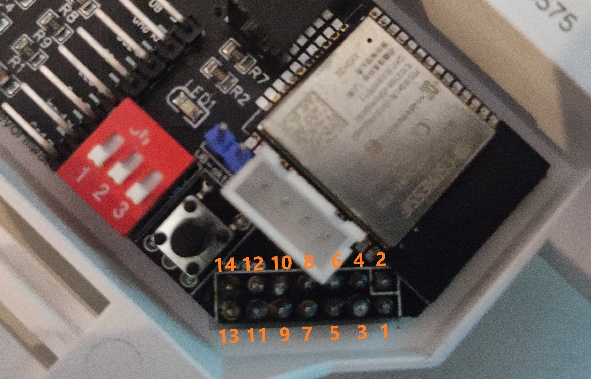

# Anleitung zur überprüfung der Platine

Da der Melder gegen Kurzschlüsse nicht wirklich gesichert ist (gegen verpolen wiederum schon),

sollte nach den Lötarbeiten an den Stiftleisten eine Messtechnische Überprüfung durchgeführt werden !

Volgende Werte sollten mit einen Multimeter (Wiederstände) ermittelt werden.

Die Pinbelegung ist wie im Schaltplan ebenfalls zu finden.

### Erklärung über Abkürzungen

"0 (KS)" ist ein Kurzschluss (direkte Verbindung)

"- (DB)" ist ein Drahtbruck (Wiederstand geht ins Unendliche, keine Verbindung)

### Tabelle

<table>
  <tr>
    <th>Pin A</th>
    <th>Pin B</th>
    <th>Wiederstand in Ohm</th>
  </tr>
  <tr align="center">
    <td>9</td>
    <td>10</td>
    <td>0 (KS)</td>
  </tr>
  <tr align="center">
    <td>7</td>
    <td>8</td>
    <td>0 (KS)</td>
  </tr>
  <tr align="center">
    <td>5</td>
    <td>6</td>
    <td>0 (KS)</td>
  </tr>
  <tr align="center">
    <td>3</td>
    <td>4</td>
    <td>- (DB)</td>
  </tr>
  <tr align="center">
    <td>1</td>
    <td>2</td>
    <td>- (DB)</td>
  </tr>
  <tr align="center">
    <td>13</td>
    <td>11</td>
    <td>12 k</td>
  </tr>
  <tr align="center">
    <td>13</td>
    <td>9</td>
    <td>- (DB)</td>
  </tr>
  <tr align="center">
    <td>13</td>
    <td>7</td>
    <td>- (DB)</td>
  </tr>
  <tr align="center">
    <td>13</td>
    <td>5</td>
    <td>24 k</td>
  </tr>
  <tr align="center">
    <td>13</td>
    <td>4</td>
    <td>- (DB)</td>
  </tr>
  <tr align="center">
    <td>13</td>
    <td>3</td>
    <td>- (DB)</td>
  </tr>
  <tr align="center">
    <td>13</td>
    <td>2</td>
    <td>- (DB)</td>
  </tr>
  <tr align="center">
    <td>13</td>
    <td>1</td>
    <td>- (DB)</td>
  </tr>
  <tr align="center">
    <td>11</td>
    <td>9</td>
    <td>- (DB)</td>
  </tr>
  <tr align="center">
    <td>11</td>
    <td>7</td>
    <td>- (DB)</td>
  </tr>
  <tr align="center">
    <td>11</td>
    <td>5</td>
    <td>12 k</td>
  </tr>
  <tr align="center">
    <td>11</td>
    <td>4</td>
    <td>- (DB)</td>
  </tr>
  <tr align="center">
    <td>11</td>
    <td>3</td>
    <td>- (DB)</td>
  </tr>
  <tr align="center">
    <td>11</td>
    <td>2</td>
    <td>- (DB)</td>
  </tr>
  <tr align="center">
    <td>11</td>
    <td>1</td>
    <td>- (DB)</td>
  </tr>
  <tr align="center">
    <td>9</td>
    <td>7</td>
    <td>- (DB)</td>
  </tr>
  <tr align="center">
    <td>7</td>
    <td>5</td>
    <td>- (DB)</td>
  </tr>
  <tr align="center">
    <td>5</td>
    <td>4</td>
    <td>- (DB)</td>
  </tr>
  <tr align="center">
    <td>5</td>
    <td>3</td>
    <td>- (DB)</td>
  </tr>
  <tr align="center">
    <td>4</td>
    <td>2</td>
    <td>- (DB)</td>
  </tr>
  <tr align="center">
    <td>4</td>
    <td>1</td>
    <td>- (DB)</td>
  </tr>
  <tr align="center">
    <td>3</td>
    <td>2</td>
    <td>- (DB)</td>
  </tr>
  <tr align="center">
    <td>3</td>
    <td>1</td>
    <td>- (DB)</td>
  </tr>
</table>