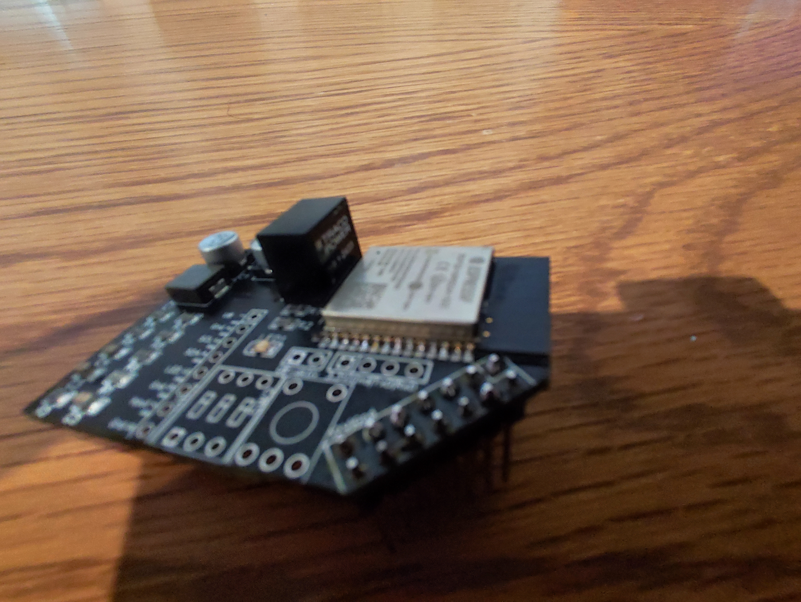

# Anleitung zu erhalt der Platine und Anpassung

Ich empfehle den Platinen Hersteller [JLCPCB](https://jlcpcb.com/), unter [Platine](https://github.com/Sefina-DS/Gira-OTM-Adapter/tree/main/Platine) finden sie die 3 benötigten Dateien, die Gerber- Datei, um die Leiterbahn herzustellen, die BOM- Datei für die Teile und die PAP- Datei für die definierten Ort der Teile.

Sie erhalten dann:

Es fehlen noch Bauteile, die Sie selbst besorgen müssen:

### Material

1x TSR- 2433 [-> Conrad <-](https://www.conrad.de/de/p/tracopower-tsr-1-2433-dc-dc-wandler-print-24-v-dc-3-3-v-dc-1-a-75-w-anzahl-ausgaenge-1-x-156671.html)

1x 3 Pol. DIP Schalter [-> Conrad <-](https://www.conrad.de/de/p/tru-components-dsr-03-dip-schalter-polzahl-num-3-slide-type-1-st-704837.html)

1x Switch [-> Amazon <-](https://www.amazon.de/Youmile-100er-Pack-Miniatur-Mikro-Taster-Tastschalter-Qualit%C3%A4tsschalter-Miniature-6-x-5-mm/dp/B07Q1BXV7T/ref=sr_1_3?__mk_de_DE=%C3%85M%C3%85%C5%BD%C3%95%C3%91&crid=RRXITVWKKBOK&keywords=2%2C54+taster&qid=1655029112&sprefix=2+54+taster%2Caps%2C83&sr=8-3)

1x Stiftleiste 2 x 7 x 2,54 x 19 [-> Amazon <-](https://www.amazon.de/sourcing-map-Zweireihig-Stiftleiste-Stiftleisten-Black-Silver-Tone/dp/B07H3SG37H)

Zum Programmieren (Optional)

1x USB zu TTL Konverter [-> Amazon <-](https://www.amazon.de/AZDelivery-Konverter-kompatibel-Arduino-inklusive/dp/B089QJZ51Z/ref=sr_1_3?__mk_de_DE=%C3%85M%C3%85%C5%BD%C3%95%C3%91&crid=1HKR209V667K1&keywords=CP2102+USB+zu+TTL+Konverter&qid=1655030866&sprefix=cp2102+usb+zu+ttl+konverter%2Caps%2C76&sr=8-3)

1x Stiftleiste 1 x 2 x 2,54 und 1 x 4 x 2,54 [-> Amazon <-](https://www.amazon.de/Pin-Stiftleiste-40-Wege-Pitch-Streifen-5-polig-vergoldet/dp/B00QXBRCKG/ref=sr_1_3?keywords=stiftleiste+2%2C54&qid=1655030292&sr=8-3)

JST Buchsen/Stecker (Achtung Zange benötigt) [-> Amazon <-](https://www.amazon.de/beihuazi%C2%AE-Steckverbinder-Connector-M%C3%A4nnlich-Weiblich/dp/B087LSB7ZD/ref=sr_1_6?__mk_de_DE=%C3%85M%C3%85%C5%BD%C3%95%C3%91&crid=2JOU1MBK4EX5E&keywords=JST+buchse+2%2C54&qid=1655030542&sprefix=jst+%2Caps%2C60&sr=8-6)

Für Erweiterungen

1x Stiftleiste 1 x 8 x 2,54 gebogen [-> Amazon <-](https://www.amazon.de/10x-54mm-Stiftleiste-einreihig-gewinkelt/dp/B075MD9N43/ref=sr_1_6?crid=12WXY1EGABMY3&keywords=stiftleiste+gewinkelt+2%2C54&qid=1655030717&sprefix=stiftleiste+gewinkelt%2Caps%2C83&sr=8-6)

### Platine Zusammenbau

Die Stiftleisten sind für die Spannungsversorgung und die Kommunikation mit dem Rauchmelder verantwortlich,

Der TSR 2433 regelt die Spannung, die von dem Melder kommt auf die benötigten 3,3V, in Verbindung mit den Kondensatoren und der Spule ist für eine stabile Spannungsversorgung gesorgt,

Ich nutze als Programmierschnittstelle eine Verpolsichere 4 Pin-Buchse,

der Taster ist zum Resetten des ESP´s,

die Jumperpins ist zum Aktivieren der Spannungsversorgung über das Programmierinterface,

### ACHTUNG nicht Fremdversorgungen und Jumper gleichzeitig nutzen!

Die Stiftleiste ist für die Externe LED, Lichtsensor und ein BME 280 zur Raumluftüberwachung,

Die DIP Schalter sind für bestimmte Modi,

1: Programmiermodus
2: W-Lan Access Point Modus
3: Werks resett aller Einstellungen

### Überprüfung der Platine :

[Hardware - Platine (Überprüfung)](https://github.com/Sefina-DS/Gira-OTM-Adapter/wiki/Hardware-:-Platine-(Überprüfung))
