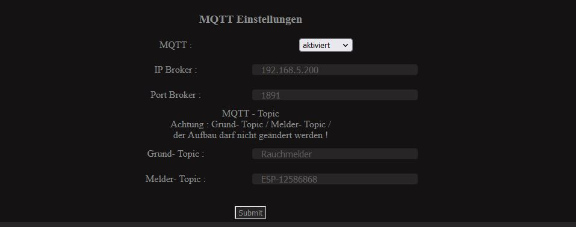

### MQTT Einstellungen

* Unter "IP Broker" tragen wir die IP des MQTT-Brokers ein
* Unter "Port Broker" tragen wir den Port des Brokers ein mit dem wir uns connecten
* Unter "Grund- Topic" (Standard ist Rauchmelder) benötigen wir ein Übergeordnetes Topic unter dem wir alle Melder und -WICHTIG- alle Melder Gruppen und Alarmierungsgruppen finden (Das Topic muss bei allen Meldern gleich sein!)
* Unter "Melder- Topic" können wir das Topic für diesen Melder eintragen, dass kann frei gewählt werden und ist zur Einteilung der Melder nutzbar

### MQTT Topics und Funktionen Beispiel: Rauchmelder/ESP-12586868/

> Rauchmelder/ESP-12586868/Melder-Diagnose/ (werden direkt aus dem Melder ausgelesen)
>
>> Spannungsversorgung Ext. | true / false (Spannung Versorgung über Stützklemme)
>>
>> Betriebsstunden | Zahl (Betriebsstunden seit dem der Melder läuft)
>>
>> Seriennummer | String (Ausgelesene Seriennummer des Melders)
>>
>> Temperatur-1 | Zahl (Temperatursensor 1 - gemessener Wert)
>>
>> Temperatur-2 | Zahl (Temperatursensor 2 - gemessener Wert)
>>
>> Batteriespannung | Zahl (Gemessener Wert des 9V Blockes des Melders)
>>
>> Verschmutzung_% | Zahl (Ausgelesener Wert des Melders)
>>
>> Rauchkammerwert | Zahl (Ausgelesener Wert des Melders)
>>
>> Anzahl_Optisch-Alarm | Zahl (Zähler für Lokale Optische Alarme)
>>
>> Anzahl_Temperatur-Alarm | Zahl (Zähler für Lokale Temperatur Alarme)
>>
>> Anzahl_Alarm_Kabel | Zahl (Zähler für Alarme über Stützklemme des Melders)
>>
>> Anzahl_Alarm_Funk | Zahl (Zähler für Alarme über Modulsteckplatz des Melders)
>>
>> Anzahl_Test-Alarm_Local | Zahl (Zähler für Testalarme über Taster des Melders)
>>
>> Anzahl_Test-Alarm_Kabel | Zahl (Zähler für Testalarme über Stützklemme des Melders)
>>
>> Anzahl_Test-Alarm_Funk | Zahl (Zähler für Testalarme über Modulsteckplatz des Melders)
>>
> Rauchmelder/ESP-12586868/ESP-Status/ (Werte des ESP´s)
>
>> ESP-ID | String (Einmalige ID des ESP´s (anhand der Mac erstellt))
>>
>> Mac Adresse | String (Mac Adresse des W-Lan Modules)
>>
>> IP Adresse | String (Derzeitige IP Adresse des ESP´s)
>>
>> Betriebsstunden | Zahl (Gerechneter Wert seit Start / Reboot)
>>
>> Online | true/false (derzeitiger Wert der Verbindung)
>>
> Rauchmelder/ESP-12586868/Melder-Status/ (Werte aus dem Melder können NICHT geändert werden)
>
>> Alarm-Funk | true/false (derzeitig im Alarm- Status über dem Modulsteckplatz des Melders)
>>
>> Alarm-Optisch | true/false (derzeitig im Alarm- Status über den Optischen Sensor des Melders)
>>
>> Alarm-Thermisch | true/false (derzeitig im Alarm- Status über die Temperatursensoren des Melders)
>>
>> Testalarm-Funk | true/false (derzeitig im Testalarm- Status über dem Modulsteckplatz des Melders)
>>
>> Taster_Melder | true/false (derzeitig gedrückter Knopf am Melder)
>>
>> Kommunikation | true/false (Status der Kommunikation zwischen Adapter und Melder)
>>
>> Meldegruppe | Zahl (Zugehörige Meldegruppe des Melders)
>>
> Rauchmelder/ESP-12586868/Melder-Steuern/ (Zum steuern des Melders)
>
>> Alarm-Funk | true/false (Zum auslösen des Alarmsignales über den Adapter)
>>
>> Melder_Finden | true/false (Leises permanentes piepen zum Lokalisieren des Melders)
>>
>> Testalarm-Funk | true/false (Auslösen des Testalarmes über den Adapter)
>>
>> Reset_Test|Funk_Alarme | true/false (stummschalten von Test und Funk - Alarme)
>>
> Rauchmelder/ESP-12586868/Erweiterungen/ (Topic für Erweiterungsfunktionen)
>
>> Rauchmelder/ESP-12586868/Erweiterungen/BME-280 (BME-280 Sensor)
>>
>>> Status | String (Status über den BME-280 Sensor)
>>>
>>> Temperatur | Zahl (Temperatur auf 0,1 Wert)
>>>
>>> Druck | Zahl (Luftdruck)
>>>
>>> Feuchte | Zahl (Luftfeuchtigkeit in %)
>>>
>>> Meter über Meeresspiegel | Zahl (Berechneter Wert anhand des Druckes)
>>>
>> Rauchmelder/ESP-12586868/Erweiterungen/UB-Ext (Spannungsteiler)
>>
>>> Spannungsversorgung Exter | Zahl (Berechneter Spannungswert über die Stützklemme)
>>>
>> Rauchmelder/ESP-12586868/Erweiterungen/Lichtsensor (Lichtsensor Modifikation)
>>
>>> Lichtzahl | Zahl (gemessener Analoger Wert)
>>>
>>> Lichtwert | Zahl (Umgewandelter % Wert für die Helligkeit)
>>>

### MQTT Topics - Gruppenfunktionen: Rauchmelder/Gruppen-Steuerung/

> Rauchmelder/Gruppen-Steuerung/0/ (Gruppe, die immer vorhanden ist / wird bei neuer Gruppenzugehörigkeit erstellt)
>
>> Alarm | true/false (Auslössung des Hauptalarmes aller Melder in der Gruppe / Resetten bei Umstellung auf false)
>>
>> Testalarm | true/false (Auslössung des Testalarmes aller Melder in der Gruppe / Resetten bei Umstellung auf false)
>>
>> Melder_Finden | true/false (Leises permanentes piepen zum Lokalisieren aller Melder der Gruppe)
>>
