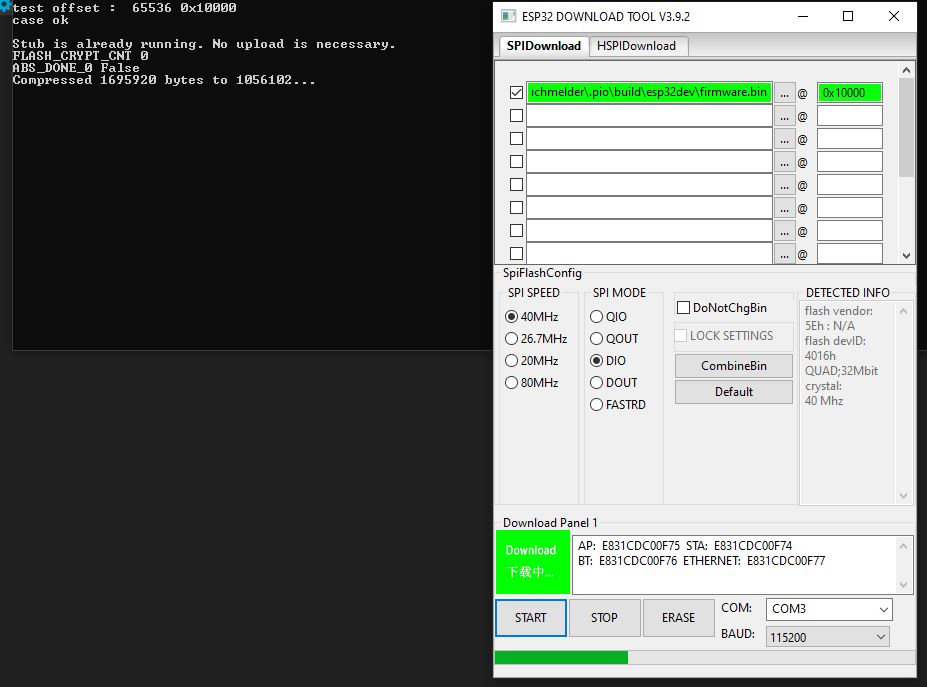
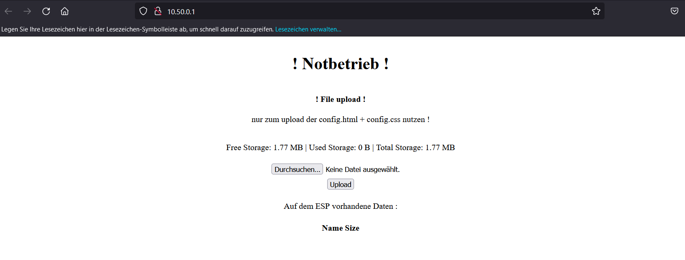
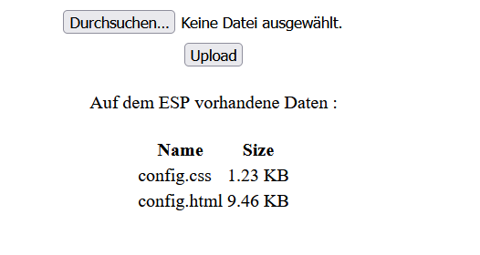
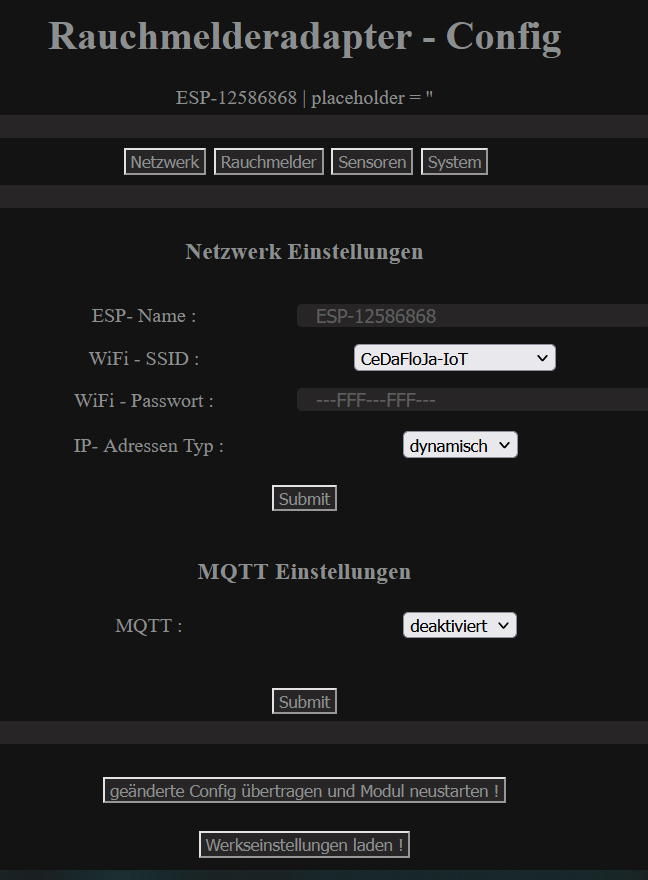

### flashen der Firmware .bin

Die Software "[Flash Download Tool](https://www.espressif.com/en/support/download/other-tools)" kann man nutzen um die "[Firmware.bin](https://github.com/Sefina-DS/Gira-OTM-Adapter/tree/main/Firmware)" auf dem ESP zu flashen.

der Jumper auf der Platine wird benötigt, wenn man die 3,3V des Flashers nutzen möchte. Zu empfehlen ist es die Platine direkt in den Melder zu flashen und die Stromversorgung des Melders zu nutzen.

Um den ESP in den Flash Modus zu versetzen: Dipschalter 1 auf ON (Rest auf OFF) und mit dem Taster den ESP resetten.

### Erstinbetriebnahme

Der ESP erstellt ein eigenes W-Lan mit dem Namen ESP-XXXXXXXX (die Xe sind durch eine einmalige ID ersetzt)

Die IP des ESP´s ist 10.50.0.1

Ihr müsst euch nun mit dem W-Lan verbinden und die IP anwählen.

### Notbetrieb

Ist auf den ESP keine config.html Datei vorhanden geht der ESP in den Notbetrieb, sodass man die Datei hochladen kann

Sind die [Datein](https://github.com/Sefina-DS/Gira-OTM-Adapter/tree/main/Data) hochgeladen, kann der ESP mit einem Druck auf den Taster neugestartet werden. Dieser wird wieder ein W-Lan zum Konfigurieren erstellen. Der Name wird sich nicht ändern.
 
### W-Lan konfigurieren

Über die IP: 10.50.0.1 kommt ihr nun auf die Config- Seite.

Über den Reiter Netzwerk könnt ihr nun W-Lan SSID aus den gefundenen auswählen und das Passwort eintragen.

Ein Klick auf "Submit" werden die Einstellungen bis zum nächsten Neustart gespeichert.

Danach "geänderte Config übertragen und Modul neustarten!" drücken.

Der ESP startet neu und wählt sich in das eingestellte W-Lan ein.
