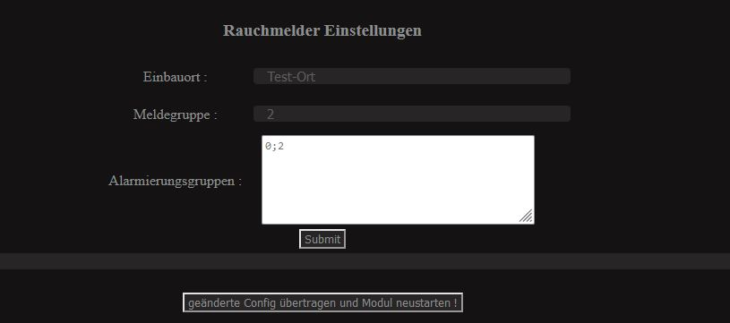

### Alarmierungsgruppen Einstellungen

Ab jetzt gibt es unter Meldegruppen auf die Option Alarmierungsgruppen.

Teilt man das Objekt in mehrere Meldegruppen ein so ist eine Komplette Alarmierung nicht mehr möglich.

Um das zu verhindern, besteht ab jetzt die Möglichkeit das der Adapter auf mehrere Meldegruppen schaut und dann mit diesen Meldegruppen ebenfalls Alarm schlägt.

Das Deaktivieren geht ebenfalls mit einem Tastendruck auf einen Melder der bereits Alarm schlägt (es gehen alle aus außer der der den lokalen Alarm ausgelöst hat.

Das unterteilen kann mit Freizeichen, Komas, Enter usw. erfolgen. Der ESP wird dann als Teilung ein „;“ nutzen.

Sollte man die Eigene Meldegruppe nicht eintragen so wird der Adapter diese Automatisch am Ende anfügen.

Die Meldegruppe 0 ist als Grundgruppe eingepflegt.

Auf diese schaut jeder Melder um eine Grundalarmierung zu gewährleisten.
